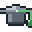

  <picture>
    <source media="(prefers-reduced-motion: reduce)" srcset="assets/header-still.png">
    
  </picture>

# Hi, I'm Matthew Thompson

## M.S. Data Science, University of Arizona · SQL · Python · R

I'm a data science graduate (M.S., University of Arizona, May 2026). I design databases and write the SQL that turns messy, large datasets into answers a business can act on, and I clean, validate, and reconcile the data before analyzing it. On one project an early model came back with a perfect score; instead of taking the win I went looking for the mistake, found leaked answer data, and re-validated until the number was real.

I also build predictive models and small software tools. My background is biology research, and I'm open to data work in other fields too.

---

##  Education

| Degree                | Institution                                  | Status                 |
| --------------------- | -------------------------------------------- | ---------------------- |
| **M.S. Data Science** | University of Arizona (Online)               | Completed, May 2026   |
| **B.S. Biology**      | Gallaudet University *(Minor: Data Science)* | Completed, May 2023   |

---

##  Research Experience

| Role | Organization | Focus |
| ---- | ------------ | ----- |
| Post-Baccalaureate Research Intern | Oklahoma State University, National Science Foundation (NSF) ON-RaMP postbaccalaureate research training program | 1 year of full-time research: statistical modeling in R (regression, analysis of variance, repeatability) on grasshopper coloration & behavior; built a Python automation script; presented at the 2024 Society for Integrative and Comparative Biology (SICB) conference; co-author of a manuscript under peer review |
| Summer Research Intern, NSF Research Experiences for Undergraduates (REU) | Maryland Sea Grant | Selected from 400+ applicants; quantified marine microbial abundance across depth gradients in R & Excel; extended into an Honors thesis |

*Full work history on [LinkedIn](https://www.linkedin.com/in/matthewqilanthompson/).*

---

##  Presentations

| Venue | Work |
| ----- | ---- |
| 2024 Society for Integrative and Comparative Biology (SICB) Conference | Poster on temperature and developmental-environment effects on grasshopper coloration and behavior |
| 2023 Esri Federal GIS Conference (Washington, D.C.) | ArcGIS Pro poster on how ocean temperature and climate trends affect coral reef ecosystems |
| 2022 NGA GeoSpectrum Conference | ArcGIS StoryMap on climate change's impact on biodiversity |

---

##  Academic Projects

These projects demonstrate my data science capabilities across healthcare analytics, machine learning, database systems, and statistical visualization:

<table>
<tr>
<td width="50%" valign="top">

<a href="https://github.com/matthewqilanthompson/Data-Science-Portfolio/tree/master/projects/database-systems/sql-nosql-databases-info579"><b>Healthcare Analytics with SQL</b></a> 
3NF schema · 1,171 patients · 53,346 encounters · 6 analytical reports

<code>MySQL</code> <code>SQL</code> <code>Python</code>

Details

Designed third normal form (3NF) database schemas across 1,171 patients and 53,346 encounters (~65MB synthetic EHR data; 8 tables built from 6 source files), then wrote 6 documented analytical reports against 5 business objectives (profitability, clinical quality, provider utilization, readmission reduction, and expansion) using multi-table joins, CTEs, correlated subqueries, and temporal analysis. Surfaced a provider workload imbalance (busiest handled 3,000+ encounters vs. under 2,000 for peers). End-to-end reproducible via Docker.

</td>
<td width="50%" valign="top">

<a href="https://github.com/matthewqilanthompson/Data-Science-Portfolio/tree/master/projects/data-science/foundation-of-data-science"><b>Healthcare Readmission Prediction</b></a> 
ROC AUC 0.858 on held-out test · 587,801 synthetic EHR training rows · 9 algorithms compared

<code>Python</code> <code>Scikit-learn</code>

Details

Built a Random Forest classifier for 30-day hospital readmission risk on 587,801 synthetic electronic health record (EHR) training rows; scored ROC AUC 0.858 on the final held-out test, holding from 0.901 in the dev phase, after comparing 9 algorithms. ROC AUC is a classifier ranking score where 1.0 is perfect.

</td>
</tr>
<tr>
<td width="50%" valign="top">

<a href="https://github.com/matthewqilanthompson/Data-Science-Portfolio/tree/master/projects/data-science/data-mining-final-project"><b>Trait-Based Prediction of Animal Taxa</b></a> 
SHAP explainability · 1,087 families · 84 phylum-level rate estimates

<code>Python</code> <code>SHAP</code>

Details

Used SHAP (SHapley Additive exPlanations), a machine-learning model-explainability technique, to identify evolutionary traits predicting animal taxonomy (1,087 families; 84 phylum-level rate estimates)

</td>
<td width="50%" valign="top">

<a href="https://github.com/matthewqilanthompson/Data-Science-Portfolio/tree/master/projects/r-analytics/data-visualization-portfolio"><b>Data Visualization Portfolio</b></a> 
Wildlife ecology · occupational safety · housing economics

<code>R</code> <code>ggplot2</code>

Details

Built statistical visualizations across wildlife ecology, occupational safety, and housing economics using ggplot2, including alluvial diagrams and faceted area plots

</td>
</tr>
<tr>
<td width="50%" valign="top">

<a href="https://github.com/matthewqilanthompson/Data-Science-Portfolio/tree/master/projects/deep-learning/emotion-classification-info557"><b>Multi-Label Emotion Classification</b></a> 
5-seed Conv1D ensemble · 14 classes · test F1 0.672

<code>Python</code> <code>Keras</code> <code>Hugging Face</code>

Details

Built a 5-seed ensemble of 1D convolutional neural networks (Conv1D / CNN) for 14-class GoEmotions text classification; scored an F1 of 0.672 on the test set (a balanced precision/recall metric where 1.0 is perfect), with a dev-to-test gap of only -0.05

</td>
<td width="50%" valign="top">

<a href="https://github.com/matthewqilanthompson/Data-Science-Portfolio/tree/master/projects/capstone/ai4hc-info698"><b>AI4HC Capstone: Rural Health Kiosk Showcase Poster</b></a> 
Team capstone · iShowcase poster (light/dark) · Python print-export pipeline

<code>HTML</code> <code>CSS</code> <code>Python</code>

Details

Team capstone at the University of Arizona AI Core, AI for Healthcare program (AI4HC), building the Rural Health Kiosk, an AI-powered healthcare access system for underserved rural communities. Designed the team's iShowcase poster (HTML/CSS, light/dark variants) and built a Python print-export pipeline; <a href="https://matthewqilanthompson.github.io/Data-Science-Portfolio/projects/capstone/ai4hc-info698/index_v1.html">view live</a>

</td>
</tr>
</table>

---

##  Software & Automation

Software projects:

<table>
<tr>
<td width="50%" valign="top">

<a href="https://github.com/matthewqilanthompson/ai-grammar-bot"><b>AI Grammar Bot</b></a> (finished project, archived) 
Discord bot · OpenAI API · MongoDB persistence · 98 passing tests

<code>Node.js</code> <code>discord.js</code> <code>MongoDB</code> <code>OpenAI</code> <code>Jest</code>

Details

A Discord bot that gives context-aware grammar feedback via the OpenAI API, with cost-monitored AI usage, MongoDB persistence (JSON fallback), per-user rate limiting, sensitive-info filtering, and 98 passing tests. Re-architected from Python to Node.js.

</td>
</tr>
</table>

---

##  Technical Skills

<b>Full skills table</b>

| Category             | Tools & Applications                                                                                                                        |
| -------------------- | ------------------------------------------------------------------------------------------------------------------------------------------- |
| **SQL & Databases**  | SQL (multi-table joins, aggregations, CTEs, correlated subqueries, temporal analysis) • MySQL • 3NF schema design (1,171 patients, 53K encounters) • ETL |
| **Data Quality**     | Data validation & reconciliation • missing-link checks • data-leakage detection • cross-validation of measurement methods |
| **Languages**        | SQL • Python (pandas, NumPy, scikit-learn) • R (tidyverse) • JavaScript / Node.js                                                            |
| **Reporting & Visualization** | Excel (research use) • Tableau (coursework) • ggplot2 (advanced plots, alluvial diagrams) • Matplotlib • analytical report writing |
| **Statistics**       | Linear regression • ANOVA • hypothesis testing • experimental design • repeatability analysis                                                |
| **Machine Learning** | Scikit-learn (classification, model comparison) • Random Forest (readmission prediction, ROC AUC 0.858 on held-out test, 0.901 on dev) • SHAP / SHapley Additive exPlanations (model explainability) • NLP / transformer fine-tuning (RoBERTa) |
| **Development**      | Git • Docker • Jupyter • RMarkdown / Quarto (reproducible research, automated reporting)                                                     |

---

##  What I'm Looking For

Open to data work where domain knowledge and analytics overlap.

**Domain interests**: Life sciences, healthcare, environmental & ecological data, spatial/GIS, and climate & conservation, and I'm open to new domains.

**What I bring**:

- **Data integrity**: cleaning, validating, and reconciling data before analysis. On one project I caught a leakage error inflating my model and re-validated until it held.
- **Technical breadth**: SQL, R, and Python across the data lifecycle, covering database design, statistics, ML, and visualization
- **Research background**: a year of full-time research at Oklahoma State University (NSF ON-RaMP) and a summer NSF REU internship
- **Examples**: 3NF database design over 53K synthetic patient encounters, an ML model at ROC AUC 0.858 on a held-out test set (0.901 on dev), and statistical analyses spanning wildlife ecology to housing economics

---

##  Connect

  <a href="https://www.linkedin.com/in/matthewqilanthompson/"><b>LinkedIn</b></a> &nbsp;·&nbsp;
  <a href="mailto:matthewqilanthompson.work@gmail.com"><b>Email</b></a> &nbsp;·&nbsp;
  <a href="https://github.com/matthewqilanthompson/Data-Science-Portfolio"><b>Portfolio</b></a>

